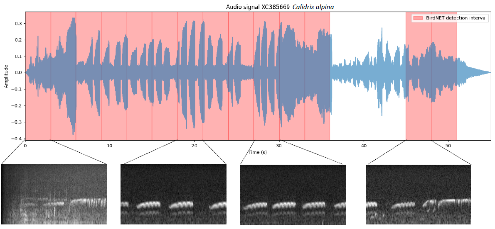

## AVISNet: An Edge-Computing Model for Acoustic Identification of Bird Species in Doñana


<p align="center">
  <a href="https://doi.org/10.1371/journal.pone.0360378">
    
  </a>
  <a href="https://github.com/DVM000/DonanaAcousticModel">
    
  </a>
  
</p>

---

<p align="center">
  
</p>

<p align="right">
  <sub>
    Image generated with Google Gemini Notebook
  </sub>
</p>

**AVISNet** (Acoustic Vocalization Identification Network) is a lightweight deep learning framework for the automatic acoustic identification of bird species associated with Doñana National Park (southwestern Spain) - 336 bird species and an additional 'other' class. List available [here](Data/SpeciesList.txt).

Designed for **passive acoustic monitoring (PAM)**, AVISNet provides efficient bird species classification while considering the computational and energy constraints of embedded devices.  AVISNet compact models are based on MobileNet architectures and process audio through 3-second analysis windows represented as Mel spectrograms. Few-shot learning (FSL) allow extending the classification capacity to under-represented species with limited training data.

This repository provides trained models, inference scripts and supporting tools for applying AVISNet to bird sound identification and ecological monitoring.


## Citation

This repository accompanies the following scientific publication:

**Velasco-Montero, D., Solís-Martín, D., Fernández-Berni, J., Bastianelli, G., & Bustamante, J. (2026).** AVISNet: An edge-computing model for acoustic identification of species from the Doñana bird community. *PLOS ONE*, 21(11), e0360378.

[https://doi.org/10.1371/journal.pone.0360378](https://doi.org/10.1371/journal.pone.0360378)

If you use AVISNet, its models or the code provided in this repository in your research, please cite the following publication:

```bibtex
@article{10.1371/journal.pone.0360378,
    doi = {10.1371/journal.pone.0360378},
    author = {Velasco-Montero, Delia AND Solís-Martín, David AND Fernández-Berni, Jorge AND Bastianelli, Giulia AND Bustamante, Javier},
    journal = {PLOS ONE},
    publisher = {Public Library of Science},
    title = {AVISNet: An edge-computing model for acoustic identification of species from the Doñana bird community},
    year = {2026},
    month = {11},
    volume = {21},
    url = {https://doi.org/10.1371/journal.pone.0360378},
    pages = {1-22},
    number = {11},
}
```

## Repository structure

```text
DonanaAcousticModel/
│
├── Data/           # Data-related resources
├── Models/         # Trained neural network models
├── Notebooks/      # Jupyter notebooks and examples
├── Testing/        # Audio inference and evaluation scripts
├── util/           # Supporting utilities
│
├── requirements    # Python dependencies
├── version.txt     # Version information
└── README.md
```

## Installation

Clone the repository:

```bash
git clone https://github.com/DVM000/DonanaAcousticModel.git
cd DonanaAcousticModel
```

Install the required Python dependencies:

```bash
pip install -r requirements
```


### Models

The `Models/` directory contains the trained neural network weights.

Model filenames follow this convention:


`<CNN>-<resolution>-<n_labels>-<extra>`

Where:

- `CNN`: neural network architecture.
- `resolution`: input spectrogram resolution (128 or 224).
- `n_labels`: number of classification labels.
- `wi`: weight imprinting, `ft`: fine-tuning, `q`: quantized model.


AVISNet-224 uses 224 × 224 input spectrograms, whereas AVISNet-128 uses 128 × 128 spectrograms. The latter is intended for applications with tighter computational and energy constraints.

The main **AVISNet** model configurations include:

| Model | Configuration |
|---|---|
| `mobilenet-224-337wi-ft.*` | AVISNet-224, 337 classes |
| `mobilenet-128-337wi-ft.*` | AVISNet-128, 337 classes |

Additionally, models trained on a subset of **305 species** are denoted as *AVISNet-224 (305)* and *AVISNet-128 (305)*, corresponding to:

| Model | Configuration |
|---|---|
| `mobilenet-224-305.*` | AVISNet-224, 305 classes |
| `mobilenet-128-305.*` | AVISNet-128, 305 classes |


See more information [here](Models/README-models.md).

### Testing

End-to-end utilities to load a trained model and evaluate it on audio files, producing classification results.

- `analyze-audios-tflite.py`: TFLite-based script, for edge inference.
- `analyze-audios.py`: TensorFlow-based script.

AVISNet can be used to analyze audio recordings and generate species predictions as exemplified:

```cd Testing```

```python analyze-audios-tflite.py --i <audiofolder> --o <predictionsfolder> --min_conf 0.5 --overlap 0```

```python analyze-audios.py --i <audiofolder> --o <predictionsfolder> --min_conf 0.5 --overlap 0```

Where:

- `--i`: directory containing the input audio recordings.
- `--o`: directory where prediction files will be stored.
- `--min_conf`: minimum confidence threshold for retaining predictions.
- `--overlap`: temporal overlap between consecutive analysis windows, in seconds.

The commands above illustrate the repository's inference interface. The appropriate confidence threshold and overlap should be selected according to the intended application and analysis strategy.

Predictions are reported as temporal detections in a BirdNET-like way, including the beginning and end of each analysis window, the predicted species, its confidence score and the source recording. See example prediction file `example-predictions.txt`:

```cat example-predictions.txt 
0.0     3.0     Bubo bubo       1.00    113954.mp3
6.0     9.0     Bubo bubo       1.00    113954.mp3
12.0    15.0    Ardea cinerea   0.97    113954.mp3
15.0    18.0    Bubo bubo       1.00    113954.mp3
```

Each row represents a 3-second analysis window:

| Column | Description |
|---|---|
| Start | Beginning of the analysis window (seconds) |
| End | End of the analysis window (seconds) |
| Species | Predicted bird species (scientific name) |
| Confidence | Model prediction score |
| File | Original audio filename |

### Notebooks

- `example-analyze-tflite.ipynb`: demonstrates model loading, audio analysis and visualization of classification results using TensorFlow Lite.


## Model evaluation

AVISNet was evaluated using two complementary approaches:

1. **Focal recordings:** audio recordings predominantly containing a single bird species.
2. **Soundscapes:** real-world acoustic recordings containing multiple species, overlapping vocalizations and environmental noise.

### Evaluation results

Evaluation was conducted on two different datasets:

**1) Focal Recordings**

Performance metrics on focal recordings from Xeno-Canto and iNaturalist Sounds, using a confidence threshold of 0.5 and considering the top-1 prediction averaged across 3-second windows:


| Model                     | Top-1 Accuracy | F1-score (Macro) |
|--------------------------|----------------|------------------|
| AVISNet-224              | 0.8025         | 0.6958           |
| AVISNet-128              | 0.7680         | 0.6558           |
| BirdNET                  | 0.8623         | 0.7850           |


**2) Soundscapes**

Performance metrics for three different soundscape datasets, to assess performance under realistic acoustic conditions. Results are reported at two complementary levels: 

- **Vocalization level:** identification of individual species occurrences. **5-min census-level** for Doñana2425.
- **Dataset level:** identification of species present across an entire recording or dataset, providing information about local community composition.


| Dataset        | Model       | P (Voc) | R (Voc) | F1 (Voc) | P (Dataset) | R (Dataset) | F1 (Dataset) |
| -------------- | ----------- | ---------------- | ---------------- | ----------------- | ----------- | ----------- | ------------ |
| **Doñana2425** | AVISNet-224 | 0.32             | 0.35             | 0.33              | 0.43        | 0.80        | 0.56         |
|                | AVISNet-128 | 0.29             | 0.29             | 0.29              | 0.43        | 0.79        | 0.56         |
| **WABAD**      | AVISNet-224 | 0.43             | 0.34             | 0.38              | 0.56        | 0.98        | 0.71         |
|                | AVISNet-128 | 0.39             | 0.32             | 0.35              | 0.58        | 0.97        | 0.72         |
| **NIPS4BPlus** | AVISNet-224 | 0.61             | 0.29             | 0.39              | 0.49        | 0.80        | 0.61         |
|                | AVISNet-128 | 0.41             | 0.34             | 0.38              | 0.53        | 0.78        | 0.63         |


These results highlight the potential of AVISNet for ecological monitoring, particularly when the objective is to identify the bird community present over extended observation periods. The results also demonstrate that reducing the input resolution from 224 × 224 to 128 × 128 has a relatively limited impact on dataset-level classification performance.

The dataset supporting the results is available through [Zenodo](https://doi.org/10.5281/zenodo.17732103).


## Computational efficiency and embedded deployment

A key contribution of AVISNet is its suitability for deployment on low-power embedded devices used in autonomous acoustic monitoring. The models were benchmarked on two Raspberry Pi platforms using TensorFlow Lite for network inference: Raspberry Pi 4 Model B and Raspberry Pi Zero 2 W. The experimental results demonstrate that AVISNet can achieve:

- Up to **4.7× faster inference** compared with BirdNET.
- Up to **71.8% lower energy consumption**.
- Real-time or near-real-time processing on resource-constrained hardware.


These improvements make AVISNet particularly suitable for autonomous passive acoustic monitoring systems, where computational resources and battery lifetime are important constraints. On-device inference also enables local processing of audio recordings, potentially reducing data transmission requirements and allowing selective storage of relevant acoustic events.


## Data and resources

The models were developed using bird vocalizations collected from [Xeno-Canto](https://xeno-canto.org/) and [iNaturalist Sounds](https://proceedings.neurips.cc/paper_files/paper/2024/hash/ef3713b8d72266e803f9346088fed92d-Abstract-Datasets_and_Benchmarks_Track.html). These recordings were pre-segmented using BirdNET, to obtain 3-second segments ready for training:


